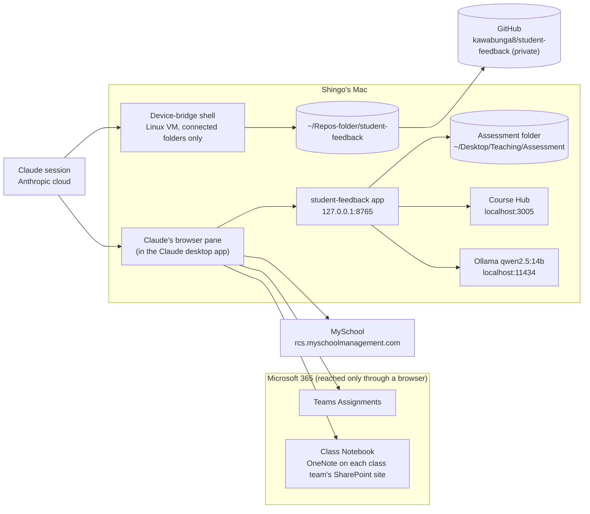

# Architecture — assessment workflow

What the pieces are, where each one runs, how student work moves between
them, and the limits that decide where each step has to happen. Companion to
`WORKFLOW.md` (the plan and current status) and `TEAMS-ASSIGNMENT-SETUP.md`
(how to set up an assignment so this all runs cleanly). Last updated
2026-10-30.

## Design goal: local first

Shingo's goal (2026-10-30): the local LLM on the Mac runs most of the
process. Student work stays on the Mac wherever it can, and routine runs
don't need a Claude session. Claude builds and maintains the tooling and
handles what the local side can't. This document describes the system as it
is today and, under "Target", how it moves toward that goal.

## Status at a glance (2026-10-31)

| Part | Status |
|---|---|
| student-feedback app and `feedback.py`: drafting, rule checks, level sentence, Course Hub class lists | Implemented and in use |
| Prompt guard: student work is evidence, not instructions | Implemented 2026-10-31 |
| Teacher workspace (`ui/workspace.js`, `ui/workspace.css`): Design assignment, Setup, Collect, Draft & review, Export & posting; review marks that any later edit voids; reviewed JSON snapshot; **assisted posting** (open Teams/MySchool, copy the approved feedback, comment and level code, tick when done; edits after posting are flagged) | Implemented 2026-10-31; checked in a browser with synthetic data and a stand-in model. Not saved automatically (export before closing); the snapshot is not posting authorization; automated collection and posting not connected |
| Saved assignment records, Design step and Choose from Teams (`ui/assignment.js`; `/api/assignments`, `/api/class-map`) | Implemented 2026-10-31 (steps 1 and 2 of the assignment-record plan); checked in a browser with synthetic data. Choose from Teams reads pasted Student view text for now; the read-only picker, Create draft in Teams, and refresh with change detection are not built |
| Persistent assessment sessions (`manifest.json` in the assignment's Assessment folder; `/api/session`) | Implemented 2026-10-31; checked in a browser with synthetic data and a stand-in model. A first, smaller version of the manifest: no collection outcomes, captures or name mapping yet |
| Engine switch (Ollama / LM Studio) | Implemented; tested against stand-in servers only. Ollama is the only engine installed |
| `stage_submissions.py` | Implemented (built from the other Claude account); not run in the 2026-10-30/31 sessions |
| Teams and MySchool click-paths | Mapped by hand; the posting actions (Teams Return, MySchool save) are **not yet verified** |
| `tools/spike_onenote_text.py` | **Typed page: passed (2026-10-31).** On one real typed page, the automated Chrome profile signed in, the script found OneNote's `#PageContentContainer` (3,271 characters, menus and navigation left out), detected no non-text elements in it, and Shingo confirmed by eye that every answer was there, in order, to the bottom of the page. **Not yet tested:** a page with a pasted image, a page with handwriting, a page with more than one text box, and moving between students unattended |
| `skills/phase-b-upload/SKILL.md` | Draft, pilot mode; posting unverified |
| Data contracts: manifest, name mapping, collection outcomes, approval record, posting states | **Proposed** (decided 2026-10-31); not built |
| `collect.py`, vision fallback, `post_teams.py`, `post_myschool.py`, app buttons | **Proposed**; not built |

## Overview

## Components

| Component | Runs where | Role | Holds student data? |
|---|---|---|---|
| `student-feedback` app (`app.py`) | Mac, `127.0.0.1:8765` | Web page for loading work, setting levels, drafting and exporting feedback | Yes, on the Mac only |
| `feedback.py` | Mac | Prompt, model call (Ollama or LM Studio), and batch CLI (`<name>.feedback.md` per student) | Yes, on the Mac only |
| `stage_submissions.py` | Mac | Phase A staging: matches collected files to the live class list and writes the Assessment folder | Yes |
| Ollama, `qwen2.5:14b` | Mac, `localhost:11434` | Local model engine (the default); nothing goes to a cloud model for drafting | Yes, on the Mac only |
| LM Studio (not installed) | Mac, `localhost:1234` (OpenAI-style API) | Optional second engine. The app still supports it; LM Studio and its MLX model were removed on 2026-10-31 after testing (see "Engine choice") | Only if reinstalled |
| Course Hub | Mac, `localhost:3005` (with Colima and a shared database) | Courses, quarter dates, class lists | Class lists |
| Assessment folder | `~/Desktop/Teaching/Assessment/<year>/<quarter>/<course>/<assignment>/` | Phase A output, Stage 3 review, Phase B input | Yes |
| Claude session (Cowork) | Anthropic's cloud, linked to the Mac | Runs Phase A and Phase B: reads submissions, drives the browser, runs scripts | Reads work and feedback while working |
| Device-bridge shell | A Linux VM on the Mac | Runs commands in folders connected to the session; edits this repo | Only what's in connected folders |
| Claude's browser pane | Inside the Claude desktop app on the Mac | Teams, OneNote, MySchool, and the feedback app | On screen |
| Claude in Chrome | Shingo's Chrome, through the extension | Alternative browser | On screen |
| Teams Assignments | Microsoft 365 | Assignments, submissions, feedback, Return | Yes |
| Class Notebook | OneNote, stored on each class team's SharePoint site | Main place students submit | Yes |
| MySchool | `rcs.myschoolmanagement.com` | Proficiency levels and comments | Yes |
| GitHub repo (private) | GitHub | Code, docs, skill copies | No (see "Privacy boundaries") |

## On the Mac

**Starting things.** `./start.sh` is a thin wrapper over
`~/Repos-folder/rcs-launcher/rcs.sh`.

- `./start.sh` (light mode): Ollama and the app only. No Course Hub, so the
  page shows an orange note, uses its saved course list, and has no class
  lists (names are typed). Uses roughly the model's memory, about 9 GB.
- `./start.sh --with-course-hub`: also starts Colima, the shared database and
  Course Hub, for live courses and class lists.
- `./start.sh stop [--with-course-hub]` stops what it started.
- `~/Desktop/Student Feedback.app` (built from `launcher/`) starts light mode
  and opens the page.

**Course list fallbacks.** Course Hub (live) → `courses.cache.json` (the last
successful live copy) → `courses.json` (kept by hand). `department_rules` in
`courses.json` picks which standards PDF in `standards/` applies.

**The app's local HTTP interface.** The app serves only on `127.0.0.1:8765`
and refuses requests with any other `Host` header, which stops a web page
from using DNS rebinding to read class lists.

| Method | Path | Purpose |
|---|---|---|
| GET | `/api/courses` | Current courses and quarters (from Course Hub or the fallbacks) |
| GET | `/api/roster?name=&quarter=` | Class list for a course (used by `stage_submissions.py`) |
| GET | `/api/assessments` | Folders under the Assessment folder that hold work |
| GET | `/api/standards` | Parsed learning-standards PDFs |
| GET | `/api/models` | Models from both engines, grouped by engine, plus which engine isn't running |
| GET | `/api/assignments` | Saved assignment records, newest first |
| GET | `/api/assignments/<id>` | One saved assignment record |
| POST | `/api/assignments` | Save a new version of an assignment record (JSON only, from the app's page) |
| GET, POST | `/api/class-map` | Confirmed Teams class to Course Hub offering matches, per school year |
| GET | `/api/session?assignment=` | The saved session for an assignment (its students and where it is stored) |
| POST | `/api/session` | Save the session (JSON only, from the app's page; refused if saved elsewhere since it was loaded) |
| POST | `/api/parse` | Split uploaded files into one entry per student |
| POST | `/api/load` | Load one Assessment folder |
| POST | `/api/generate` | Draft feedback for one student |

The app calls Course Hub (`/api/quarters`, `/api/courses`,
`/api/courses/<id>/roster`) with a key read server-side from `.env.local`,
Ollama (`/api/tags`, `/api/chat`, and `/api/ps` with `/api/generate` to unload), and LM Studio
(`/v1/models`, `/v1/chat/completions`). A model id with the prefix `lmstudio::` goes to LM Studio; a bare
name goes to Ollama, so older saved choices still work.

**The Mac.** MacBook Air 13-inch, M3 (2024), 16 GB, macOS 27. Writing speed for a 14B model is limited mainly by the M3's memory bandwidth (about 100 GB/s), so roughly 10 to 12 tokens a second is close to the ceiling whichever engine runs it. The Air has no fan, so a long batch slows as it warms; run batches plugged in, with other heavy apps closed.

**Memory.** This Mac has 16 GB. Measured on 2026-10-30, the MLX build of the 14B model used 8.28 GB in
LM Studio, so only one 14B model fits at a time, and the vision model (`qwen2.5vl:7b`, 6.0 GB) has to run on
its own too. When the engine changes, the app
unloads the other engine's model first (Ollama through its API; LM Studio with `lms unload --all` when the
`lms` command is installed).

**Engine choice (2026-10-31).** Ollama is the engine in use: `qwen2.5:14b` (9.0 GB) and `qwen2.5vl:7b`
(6.0 GB), stored in `~/.ollama/models`. LM Studio with the MLX build was tested on 2026-10-30 and removed on
2026-10-31; on this M3, writing speed is near the chip's ceiling whichever engine runs the model. Ollama's
own MLX mode (from version 0.19) needs more than 32 GB of memory and only covers a few newer models, so it
doesn't apply to this Mac. The app's LM Studio support stays, so another engine or model can be tried later
without code changes.

## Files and conventions

- **Assessment folder:** one `FirstName_LastName.txt` per student.
  `stage_submissions.py` also writes `_NEEDS_ATTENTION_<name>.txt` for files
  it couldn't match to the class list, and `_MISSING_SUBMISSIONS.txt`.
- **Drafts:** `feedback.py` writes `<name>.feedback.md`. When a level is set,
  the draft opens with a fixed sentence, "This work is at the <Level>[+]
  level: …", which Phase B reads to set the MySchool level.
- **Repo:** code, docs, the standards PDFs, and `skills/<name>/SKILL.md`
  copies of the workflow skills (skills are tied to a Claude account; the repo
  copy lets either account use them).
- **Planned data files (not built yet):** `name-mapping.json` per class in the course folder, and
  `manifest.json` per assignment folder, both under the Assessment folder on the Mac. `.gitignore` also
  excludes those names (and their `.tmp` files) and a `collected/` folder, in case a script is ever run
  inside the repo.
- **`Claude outputs/`:** where the Claude desktop app saves files Claude
  delivers while this folder is connected. Untracked; not part of the
  project.

## The Claude side

- **Two Claude accounts.** The Assessment Project, its docs and the account-level
  skills (`phase-a-collect-and-draft`, `push-laptop-repo-to-github`) live in
  Shingo's other account. The RCS organization account (approved by RCS for
  student work and feedback, per Shingo, 2026-10-30) can't see them, so this
  repo carries the plan and copies of the skills.
- **Device-bridge shell.** A Linux VM on the Mac that can see only the
  folders connected to the session (here, this repo). It can't reach the
  Mac's localhost (documented behaviour of the bridge; not yet tested here),
  so anything that calls the app or Course Hub, such as `stage_submissions.py`,
  runs on the Mac itself. Deleting files needs Shingo's approval each session.
- **Claude's browser pane.** Has its own browser profile and sign-in,
  separate from Chrome; it needed one Microsoft sign-in from Shingo. It
  blocks popups and new tabs opened by Claude's clicks, so Claude navigates to
  URLs directly or asks Shingo to click. Each new site needs a one-time
  approval; approved so far: `onenote.com`, `onenote.cloud.microsoft`,
  `cac-onenote.officeapps.live.com`, `127.0.0.1:8765`.
- **Claude in Chrome.** Works only when the extension is signed in to the
  same Claude account as the session; it wasn't reachable from the RCS
  account on 2026-10-30.
- **Microsoft 365 connector.** Blocked by RCS Conditional Access
  (`AADSTS53003`), so every Teams, OneNote and SharePoint step is browser
  automation.

## How student work moves

| Step | From | Through | To |
|---|---|---|---|
| Phase A: collect | Class Notebook pages, Teams attachments, SharePoint and Canva links | Claude reads them in the browser pane (screenshots for OneNote) | Collected text, one file per student |
| Phase A: stage | Collected text | `stage_submissions.py` on the Mac, checked against `/api/roster` | Assessment folder |
| Phase A: draft | Assessment folder | `feedback.py` batch, Ollama or LM Studio on the Mac | `<name>.feedback.md` drafts |
| Stage 3: review | Drafts | Shingo edits; sets levels | Approved folder |
| Phase B: post | Approved folder | Claude in the browser pane, after Shingo's go-ahead for the batch | Teams (feedback, Return) and MySchool (level, comment) |

Today only the drafting step is local. Student work passes through Claude
whenever Claude reads it in the browser or from the Assessment folder; that
is the use Shingo confirmed RCS has approved for the RCS organization
account. The target below takes Claude out of that path.

## Target: the local LLM runs most of the process (proposed 2026-10-30)

The split that makes this workable: **scripts do the navigating and
clicking** (the click-paths are already mapped), and **the local model does
bounded content tasks whose output can be checked**. A 14B model driving a
browser freely would be unreliable; transcribing, matching and drafting are
well within its reach.

| Step | Today | Target | Local model's job |
|---|---|---|---|
| Find submissions | Claude in the browser pane | `collect.py` (Playwright, on the Mac) walks each student's Class Notebook section and the Teams roster | Pick the submission page when titles don't match, using title, date and content |
| Read Class Notebook pages | Claude reads screenshots | Script reads the page text straight from the OneNote frame | Handwriting or images only: `qwen2.5vl:7b` transcribes a screenshot |
| Linked files (SharePoint, Word, PDF) | Popups blocked in the pane | Script downloads them through the signed-in browser; the app already parses .docx, .pdf and .xlsx | None |
| Stage | `stage_submissions.py` | Same | None (name matching is deterministic) |
| Draft | `feedback.py` with `qwen2.5:14b` in Ollama | Same (LM Studio stays an option) | Draft feedback; existing checks regenerate bad drafts |
| Review | Shingo | Shingo, in the app | None |
| Post to Teams | Claude (planned) | `post_teams.py` (Playwright): type feedback, Return | None |
| Post to MySchool | Claude (planned) | `post_myschool.py` (Playwright): level bubbles, comment, save | Optionally shorten the comment |
| Run report | Claude | Scripts write a log in the Assessment folder | Optional plain-language summary |
| Trigger | Ask Claude | Buttons in the app ("Collect", "Post approved") or a shell command | None |

**Claude's role in the target:** write and fix the scripts (Microsoft
changes its pages, so all selectors live in one file and fixes stay small),
extend them to new assignment types, and handle odd cases by hand.

**Why Playwright on the Mac:** it can work inside the cross-origin frames
that block Claude's tools (Teams Assignments, OneNote), popup blocking
doesn't apply, and it can reuse a persistent browser profile that Shingo
signs in to once.

**To test before building on it:**
- Whether RCS Conditional Access allows an automated browser. **Answered
  2026-10-31: yes.** The installed Chrome (`channel="chrome"`) with its own
  persistent profile, signed in once by Shingo, got in.
- Whether OneNote on the web exposes page text in the frame's DOM.
  **Answered for typed text on 2026-10-31: yes**, completely, checked by eye
  against Chrome. Handwriting and pasted images still to test. The frame (`WebApplicationFrame`) is loaded by a
  form post and has no `src`, so it can't be opened on its own; Playwright
  reads it in place.
- Memory: with 16 GB, models run one at a time (see "Memory" above).
- Speed: first LM Studio test (2026-10-30, one paragraph for one student):
  10.11 tokens/s while writing, 103 tokens, 84.30 s before the first token.
  At that rate a class of 28 takes most of an hour, so drafting suits an
  unattended batch. Ollama's timing for the same student hasn't been measured yet.
- Whether Python and Playwright are installed on the Mac. Not checked: the
  bridge shell is a Linux VM and can't see the Mac's own tools.

**Build order:** see `WORKFLOW.md`, "What to build next" (revised 2026-10-31). The data it relies on is
defined below in "Data contracts".

## Assignment records (built 2026-10-31)

The saved assignment record is the centre of an assignment: Setup, the Design step and (later) collection and
approval read the same record. Records hold no student data.

- **Where:** `~/Library/Application Support/student-feedback/assignments/asg-<date>-<random>.json`, one file per
  assignment, outside git, written atomically (temporary file, fsync, rename). `class-map.json` in the same folder
  holds Shingo's confirmed matches from a Teams class name to a Course Hub offering, per school year.
- **Contents:** local ID; title; Course Hub offering (name, label, section IDs, school year); grade; term;
  student-facing instructions; the teacher's feedback focus (a "Must include:" list, never shown to students); ticked
  standard labels; feedback length; Teams references (class name, due date, reference materials, and the title and
  instructions as imported); the design (purpose, directions, required evidence, success criteria each with how
  students show it and a linked standard, submission setup, feedback setup, notes for marking); where each Setup field
  came from and when; version, created and updated times, and a history of the last 50 saves.
- **Versions:** a save that changes something adds a version and a history entry naming the changed fields and a
  kind: `created`, `content` (instructions, feedback focus, standards or success criteria changed), `title` (only the
  name changed) or `details` (anything else). A save with no changes adds nothing.
- **Drafts and review marks:** each draft remembers the instructions and standards it was written against. When
  Setup's change, the draft is marked "possibly outdated", and its review mark is void because the review binds the
  instructions and standards. A name-only change doesn't mark drafts outdated, but it does void review marks, because
  the reviewed record includes the assignment name.
- **Course Hub is authoritative:** a saved course is found by its Course Hub section IDs first, then by name. A Teams
  class is linked to a Course Hub offering only when Shingo confirms it; the confirmed match is reused for that class
  for the school year. The grade comes from Course Hub's grades for the course (if there is more than one, Shingo
  picks); it is never guessed from the assignment name.
- **Student-facing and teacher-only stay apart:** only the title and the student-facing instructions are offered for
  copying into Teams. The feedback focus goes into Setup's instructions for the local model only, under a "Teacher's
  feedback focus (not shown to students):" heading. Notes for marking and MySchool comment guidance appear only in
  the teacher-only brief (Design preview and the top of Draft & review).
- **Two tabs:** each save names the version the page loaded; if the file has moved on since, nothing is written and
  the page offers to load the newer version or save its own on top. Saves are serialised by a lock.
- **Server guards:** saving needs a JSON request from the app's own page (`Content-Type: application/json`; any
  `Origin` must be the app's), bodies over 500 KB are refused, and record IDs must match `asg-[a-z0-9-]`.

Not built yet: the read-only Teams picker, wiring the field buttons to it, Create draft in Teams, and refresh with
change detection linked to the manifest, collection and approval (steps 3 to 6 in `WORKFLOW.md`).

## Assessment sessions (built 2026-10-31)

Reopening an assignment reopens its work. The page saves automatically, a couple of seconds after each change, to
`manifest.json` in the assignment's folder under Assessment (`Assessment/<school year>/<term>/<course>/<assignment>/`,
outside git; `manifest.json` is already in `.gitignore`). The folder is worked out from the saved assignment record the
first time and then fixed in `~/Library/Application Support/student-feedback/session-index.json`, so renaming the
assignment later doesn't strand the work. It is always inside Assessment (names are cleaned; `..` and absolute paths
can't escape). Two assignments with the same name, course and term never share a manifest: the second gets " (2)". An assignment with no students gets no manifest.

- **Saved per student** (in page order): Course Hub ID, name as shown and as uploaded, grade, work, private notes, level,
  the feedback text as edited, the separate MySchool comment, the instructions-and-standards basis the draft was written
  against, the review approval, and the Teams and MySchool "done" ticks.
- **Approvals and ticks keep what was reviewed, and the server judges them.** An approval is saved with the exact values
  that were reviewed. Whenever a session is saved or loaded, the server works out again, from the stored values and the
  *saved* assignment record, whether each approval and each posting tick still holds. It is never a stored yes/no. An
  approval is current only if the reviewed values equal the student's stored values (ID, name, work, notes, level,
  feedback, MySchool comment, grade) and the saved assignment's title, instructions plus feedback focus, course, school
  year, term and standards; and the assignment has had no content or title change since the server first saw the
  approval (the server stamps it with the assignment version then; a fresh review mark counts as a new approval).
  Otherwise the status lists the reasons ("feedback", "instructions", "assignment changed since approval", …). Editing
  anything reviewed, or saving the assignment with different instructions, voids it; changes that don't touch what was
  reviewed (feedback length, notes for marking) don't. The page shows the same result as "review again", and warns when a
  student is reviewed on the page but not approved on the server (for example, reviewed against unsaved instructions).
  `department` is part of the page's reviewed values but isn't re-derived on the server.
- **A gated reader for future posting workers.** `approved_for_posting(assignment_id)` returns only students the server finds
  approved, with their approved values and which destinations are already ticked. It raises unless `AUTOMATED_POSTING` is
  switched on, and it is **off**: no worker posts anything, and no HTTP route exposes the reader.
- **Two tabs:** each save names the session version the page loaded. If it was saved elsewhere since, nothing is written;
  the page keeps its work and offers "Load the saved session" or "Save mine on top". Autosave stays off for a session
  that couldn't be read, so it can't overwrite one it never saw.
- **Switching assignments** saves the current session first, then opens the other one's students; a new assignment starts
  with no students.

Not built: collection outcomes, the original captures, the class name mapping, destination read-back and run records (the
rest of the manifest described below), and a separate approval file. The approval is the teacher's own mark, kept with the
session and validated by the server as above.

## Data contracts (decided 2026-10-31; not built yet)

These sit around the teacher checkpoint, so collection and posting can be checked, resumed and audited.
Nothing below is in git: it all lives in the Assessment folder on the Mac.

**Manifest.** One `manifest.json` per assignment folder, keyed by each student's Course Hub ID. It points
to the class's name mapping (below) instead of copying names, so the two can't drift apart. It records:
which student and assignment the work belongs to, where it came from, when and how it was collected, any warnings, the
approval record, and the state of each destination. The original capture (page HTML, image or file) is kept
next to the extracted text. Every save is atomic: write `manifest.json.tmp` in the same folder, flush and
fsync it, then `os.replace` it over `manifest.json`, so an interrupted save can never leave a half-written
manifest. The name mapping is saved the same way.

**Student identity.** Course Hub's student ID is the key everywhere. The app already keeps it: it reads
each class list from Course Hub (`/api/courses/<id>/roster`), removes duplicates by that ID, and
`stage_submissions.py` matches against it (checked in the code on 2026-10-31). Names are mappings, not
identities: each class has one `name-mapping.json`, in its course folder
(`Assessment/<year>/<quarter>/<course>/`), keyed by Course Hub ID, giving each student's name as Teams,
MySchool and the Class Notebook show it. Shingo checks it once per class (for example at the start of a
term). Every assignment in that class uses the same mapping. Anything that doesn't match it exactly is
flagged, never guessed.

The app has kept class lists in memory only, never on disk. The manifest and the mapping change that: they
hold Course Hub IDs and names in the Assessment folder on the Mac, outside git, alongside the student work
already stored there. Shingo confirmed this on 2026-10-31, as consistent with the local-first design.

**Collection outcomes.** Each student ends collection in exactly one of these states:

| Outcome | Meaning |
|---|---|
| Collected | Text read; nothing on the page beyond text was detected |
| Collected, completeness unverified | Text read, but the page has images, canvases, drawings or embedded files, or may hold handwriting the text can't capture |
| Needs vision | The work is mainly images or handwriting; the local vision model must transcribe it, and uncertain passages are flagged, never filled in |
| Page found but empty | The right page exists but holds no work |
| Extraction failed | A technical failure; retry or check by hand |
| No submission found | No page, attachment or link for this assignment |
| Needs attention | The work couldn't be tied confidently to one student and one assignment |

Only "No submission found" may lead to feedback about missing work, and only after Shingo confirms it. A
page chosen by title returns its evidence (title, opening text, and whether it holds the student's own
answers), with an explicit "no confident match" outcome instead of a best guess. Page dates aren't
evidence: pages copied from a template keep the template's date (a 2026 submission page showed April 18,
2022).

**Task wording on the page.** Distributed pages hold the assignment's own wording, with the student's
answers written in between. Collection separates the two, using the assignment instructions from Teams, so
the drafting model assesses only what the student wrote and never credits them for the task's wording.

**Approval record.** Approval binds the whole reviewed result:
- the exact Teams feedback;
- the teacher-selected level;
- the MySchool comment (a short comment Shingo reviews separately; never cut down automatically);
- the source fingerprint (SHA-256 of the collected work);
- the assignment and rubric version (SHA-256 of the instructions and any ticked standards).

A fingerprint of all five together is stored with the time of approval. If any of them changes afterward,
the approval is void and must be given again. Posting reads only approved records.

**Posting states.** Teams and MySchool are tracked separately for each student: not started → posting →
posted, unverified → verified, or failed (with the error). A destination counts as verified only after
reading it back and finding it matches the approved record: in Teams, the feedback text shown in the
student's panel; in MySchool, the level bubble(s) and the comment. A "Returned" status alone proves
nothing, because it may come from an earlier manual return. After an uncertain result (a timeout, an
unexpected page), the script inspects the destination before clicking anything again, and a retry resumes
only the unfinished destination. Each posting attempt's run record keeps the destination identity actually
used (the student's name as matched on screen in Teams or MySchool, the assignment title, and the time), so
a later change to the name mapping can't rewrite what was posted where.

**Model safety.** The drafting model only returns text: it has no tools and can't post or browse. The prompt
marks student work as evidence and tells the model not to follow instructions inside it; the quotation
marks around the work are only a delimiter, not a defence. Teacher review stays mandatory. The automatic
checks catch rule breaks (level names, invented command terms, wording to copy, missing headings) but can't
confirm that praise is supported or that each criterion is really met; that's the teacher's review. Showing
each criterion beside the matching evidence would make that review faster (later).

## Privacy boundaries

- `.gitignore` keeps out secrets (`.env*`), student work (`submissions/`),
  generated feedback (`feedback/`), caches, and any CSV, Excel or Word
  exports. `.vercelignore` also excludes `standards/` and PDFs in case the
  folder is ever deployed.
- Student names stay out of chat replies, memory and these docs. Per-student
  run logs go only in the Assessment folder on the Mac.
- Nothing is posted to Teams or MySchool until Shingo has reviewed the
  drafts and given the go-ahead.
- Claude never types passwords. Sign-ins, MFA and consent prompts are
  Shingo's to complete.

## Known constraints and gaps (2026-10-30)

- The session couldn't be given access to `~/Desktop/Teaching/Assessment`,
  and the app's folder menu showed "No Assessment folders found". Phase B
  needs that folder connected.
- Copy and paste between browser-pane tabs didn't carry text over, so text
  read from OneNote is transcribed from screenshots and should be
  spot-checked.
- Teams' grading panel couldn't display SharePoint-link submissions, and
  opening them is a popup the pane blocks.
- Not yet verified: what Teams' Return sends to the student, and how
  MySchool's Assessment tab saves. See `WORKFLOW.md`, "What to build next".
- The test script's output must never be followed by pasting a page's source code: OneNote's page source
  holds live sign-in tokens (seen 2026-10-31). Those tokens must not be shared.
- Reading a notebook page's text can never prove it's complete: handwriting
  may not appear as a separate element. The test script reports
  completeness as unverified and counts large images, canvases, drawings
  and embedded files it can see.
