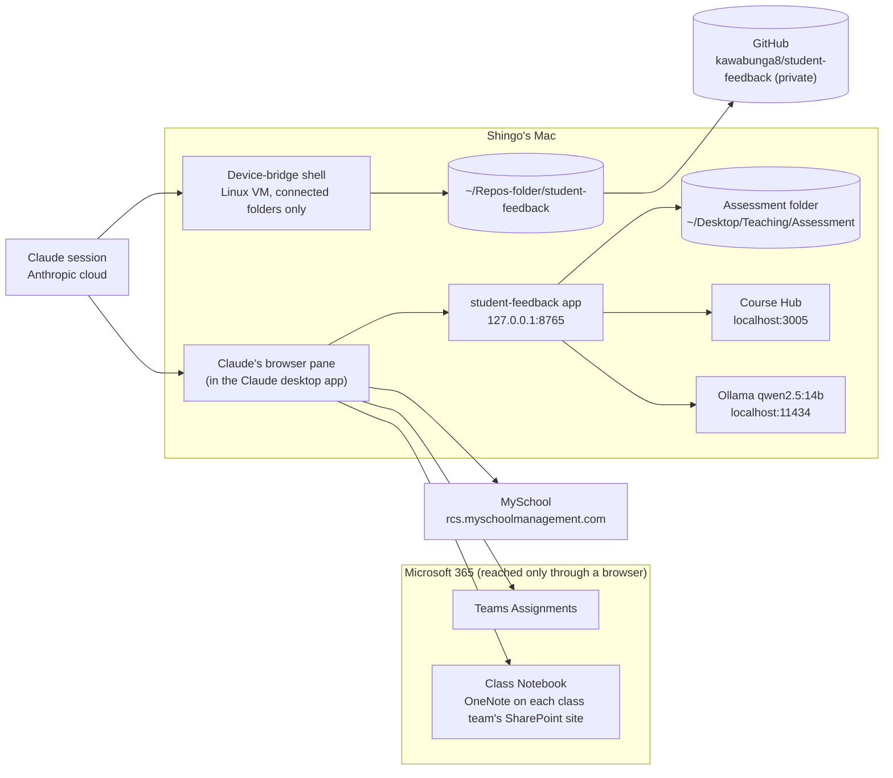

# Architecture — assessment workflow

What the pieces are, where each one runs, how student work moves between
them, and the limits that decide where each step has to happen. Companion to
`WORKFLOW.md` (the plan and current status) and `TEAMS-ASSIGNMENT-SETUP.md`
(how to set up an assignment so this all runs cleanly). Last updated
2026-10-30.

## Design goal: local first

Shingo's goal (2026-10-30): the local LLM on the Mac runs most of the
process. Student work stays on the Mac wherever it can, and routine runs
don't need a Claude session. Claude builds and maintains the tooling and
handles what the local side can't. This document describes the system as it
is today and, under "Target", how it moves toward that goal.

## Overview

## Components

| Component | Runs where | Role | Holds student data? |
|---|---|---|---|
| `student-feedback` app (`app.py`) | Mac, `127.0.0.1:8765` | Web page for loading work, setting levels, drafting and exporting feedback | Yes, on the Mac only |
| `feedback.py` | Mac | Prompt, model call (Ollama or LM Studio), and batch CLI (`<name>.feedback.md` per student) | Yes, on the Mac only |
| `stage_submissions.py` | Mac | Phase A staging: matches collected files to the live class list and writes the Assessment folder | Yes |
| Ollama, `qwen2.5:14b` | Mac, `localhost:11434` | Local model engine (the default); nothing goes to a cloud model for drafting | Yes, on the Mac only |
| LM Studio (not installed) | Mac, `localhost:1234` (OpenAI-style API) | Optional second engine. The app still supports it; LM Studio and its MLX model were removed on 2026-10-31 after testing (see "Engine choice") | Only if reinstalled |
| Course Hub | Mac, `localhost:3005` (with Colima and a shared database) | Courses, quarter dates, class lists | Class lists |
| Assessment folder | `~/Desktop/Teaching/Assessment/<year>/<quarter>/<course>/<assignment>/` | Phase A output, Stage 3 review, Phase B input | Yes |
| Claude session (Cowork) | Anthropic's cloud, linked to the Mac | Runs Phase A and Phase B: reads submissions, drives the browser, runs scripts | Reads work and feedback while working |
| Device-bridge shell | A Linux VM on the Mac | Runs commands in folders connected to the session; edits this repo | Only what's in connected folders |
| Claude's browser pane | Inside the Claude desktop app on the Mac | Teams, OneNote, MySchool, and the feedback app | On screen |
| Claude in Chrome | Shingo's Chrome, through the extension | Alternative browser | On screen |
| Teams Assignments | Microsoft 365 | Assignments, submissions, feedback, Return | Yes |
| Class Notebook | OneNote, stored on each class team's SharePoint site | Main place students submit | Yes |
| MySchool | `rcs.myschoolmanagement.com` | Proficiency levels and comments | Yes |
| GitHub repo (private) | GitHub | Code, docs, skill copies | No (see "Privacy boundaries") |

## On the Mac

**Starting things.** `./start.sh` is a thin wrapper over
`~/Repos-folder/rcs-launcher/rcs.sh`.

- `./start.sh` (light mode): Ollama and the app only. No Course Hub, so the
  page shows an orange note, uses its saved course list, and has no class
  lists (names are typed). Uses roughly the model's memory, about 9 GB.
- `./start.sh --with-course-hub`: also starts Colima, the shared database and
  Course Hub, for live courses and class lists.
- `./start.sh stop [--with-course-hub]` stops what it started.
- `~/Desktop/Student Feedback.app` (built from `launcher/`) starts light mode
  and opens the page.

**Course list fallbacks.** Course Hub (live) → `courses.cache.json` (the last
successful live copy) → `courses.json` (kept by hand). `department_rules` in
`courses.json` picks which standards PDF in `standards/` applies.

**The app's local HTTP interface.** The app serves only on `127.0.0.1:8765`
and refuses requests with any other `Host` header, which stops a web page
from using DNS rebinding to read class lists.

| Method | Path | Purpose |
|---|---|---|
| GET | `/api/courses` | Current courses and quarters (from Course Hub or the fallbacks) |
| GET | `/api/roster?name=&quarter=` | Class list for a course (used by `stage_submissions.py`) |
| GET | `/api/assessments` | Folders under the Assessment folder that hold work |
| GET | `/api/standards` | Parsed learning-standards PDFs |
| GET | `/api/models` | Models from both engines, grouped by engine, plus which engine isn't running |
| POST | `/api/parse` | Split uploaded files into one entry per student |
| POST | `/api/load` | Load one Assessment folder |
| POST | `/api/generate` | Draft feedback for one student |

The app calls Course Hub (`/api/quarters`, `/api/courses`,
`/api/courses/<id>/roster`) with a key read server-side from `.env.local`,
Ollama (`/api/tags`, `/api/chat`, and `/api/ps` with `/api/generate` to unload), and LM Studio
(`/v1/models`, `/v1/chat/completions`). A model id with the prefix `lmstudio::` goes to LM Studio; a bare
name goes to Ollama, so older saved choices still work.

**The Mac.** MacBook Air 13-inch, M3 (2024), 16 GB, macOS 27. Writing speed for a 14B model is limited mainly by the M3's memory bandwidth (about 100 GB/s), so roughly 10 to 12 tokens a second is close to the ceiling whichever engine runs it. The Air has no fan, so a long batch slows as it warms; run batches plugged in, with other heavy apps closed.

**Memory.** This Mac has 16 GB. Measured on 2026-10-30, the MLX build of the 14B model used 8.28 GB in
LM Studio, so only one 14B model fits at a time, and the vision model (`qwen2.5vl:7b`, 6.0 GB) has to run on
its own too. When the engine changes, the app
unloads the other engine's model first (Ollama through its API; LM Studio with `lms unload --all` when the
`lms` command is installed).

**Engine choice (2026-10-31).** Ollama is the engine in use: `qwen2.5:14b` (9.0 GB) and `qwen2.5vl:7b`
(6.0 GB), stored in `~/.ollama/models`. LM Studio with the MLX build was tested on 2026-10-30 and removed on
2026-10-31; on this M3, writing speed is near the chip's ceiling whichever engine runs the model. Ollama's
own MLX mode (from version 0.19) needs more than 32 GB of memory and only covers a few newer models, so it
doesn't apply to this Mac. The app's LM Studio support stays, so another engine or model can be tried later
without code changes.

## Files and conventions

- **Assessment folder:** one `FirstName_LastName.txt` per student.
  `stage_submissions.py` also writes `_NEEDS_ATTENTION_<name>.txt` for files
  it couldn't match to the class list, and `_MISSING_SUBMISSIONS.txt`.
- **Drafts:** `feedback.py` writes `<name>.feedback.md`. When a level is set,
  the draft opens with a fixed sentence, "This work is at the <Level>[+]
  level: …", which Phase B reads to set the MySchool level.
- **Repo:** code, docs, the standards PDFs, and `skills/<name>/SKILL.md`
  copies of the workflow skills (skills are tied to a Claude account; the repo
  copy lets either account use them).
- **`Claude outputs/`:** where the Claude desktop app saves files Claude
  delivers while this folder is connected. Untracked; not part of the
  project.

## The Claude side

- **Two Claude accounts.** The Assessment Project, its docs and the account-level
  skills (`phase-a-collect-and-draft`, `push-laptop-repo-to-github`) live in
  Shingo's other account. The RCS organization account (approved by RCS for
  student work and feedback, per Shingo, 2026-10-30) can't see them, so this
  repo carries the plan and copies of the skills.
- **Device-bridge shell.** A Linux VM on the Mac that can see only the
  folders connected to the session (here, this repo). It can't reach the
  Mac's localhost (documented behaviour of the bridge; not yet tested here),
  so anything that calls the app or Course Hub, such as `stage_submissions.py`,
  runs on the Mac itself. Deleting files needs Shingo's approval each session.
- **Claude's browser pane.** Has its own browser profile and sign-in,
  separate from Chrome; it needed one Microsoft sign-in from Shingo. It
  blocks popups and new tabs opened by Claude's clicks, so Claude navigates to
  URLs directly or asks Shingo to click. Each new site needs a one-time
  approval; approved so far: `onenote.com`, `onenote.cloud.microsoft`,
  `cac-onenote.officeapps.live.com`, `127.0.0.1:8765`.
- **Claude in Chrome.** Works only when the extension is signed in to the
  same Claude account as the session; it wasn't reachable from the RCS
  account on 2026-10-30.
- **Microsoft 365 connector.** Blocked by RCS Conditional Access
  (`AADSTS53003`), so every Teams, OneNote and SharePoint step is browser
  automation.

## How student work moves

| Step | From | Through | To |
|---|---|---|---|
| Phase A: collect | Class Notebook pages, Teams attachments, SharePoint and Canva links | Claude reads them in the browser pane (screenshots for OneNote) | Collected text, one file per student |
| Phase A: stage | Collected text | `stage_submissions.py` on the Mac, checked against `/api/roster` | Assessment folder |
| Phase A: draft | Assessment folder | `feedback.py` batch, Ollama or LM Studio on the Mac | `<name>.feedback.md` drafts |
| Stage 3: review | Drafts | Shingo edits; sets levels | Approved folder |
| Phase B: post | Approved folder | Claude in the browser pane, after Shingo's go-ahead for the batch | Teams (feedback, Return) and MySchool (level, comment) |

Today only the drafting step is local. Student work passes through Claude
whenever Claude reads it in the browser or from the Assessment folder; that
is the use Shingo confirmed RCS has approved for the RCS organization
account. The target below takes Claude out of that path.

## Target: the local LLM runs most of the process (proposed 2026-10-30)

The split that makes this workable: **scripts do the navigating and
clicking** (the click-paths are already mapped), and **the local model does
bounded content tasks whose output can be checked**. A 14B model driving a
browser freely would be unreliable; transcribing, matching and drafting are
well within its reach.

| Step | Today | Target | Local model's job |
|---|---|---|---|
| Find submissions | Claude in the browser pane | `collect.py` (Playwright, on the Mac) walks each student's Class Notebook section and the Teams roster | Pick the submission page when titles don't match, using title, date and content |
| Read Class Notebook pages | Claude reads screenshots | Script reads the page text straight from the OneNote frame | Handwriting or images only: `qwen2.5vl:7b` transcribes a screenshot |
| Linked files (SharePoint, Word, PDF) | Popups blocked in the pane | Script downloads them through the signed-in browser; the app already parses .docx, .pdf and .xlsx | None |
| Stage | `stage_submissions.py` | Same | None (name matching is deterministic) |
| Draft | `feedback.py` with `qwen2.5:14b` in Ollama | Same (LM Studio stays an option) | Draft feedback; existing checks regenerate bad drafts |
| Review | Shingo | Shingo, in the app | None |
| Post to Teams | Claude (planned) | `post_teams.py` (Playwright): type feedback, Return | None |
| Post to MySchool | Claude (planned) | `post_myschool.py` (Playwright): level bubbles, comment, save | Optionally shorten the comment |
| Run report | Claude | Scripts write a log in the Assessment folder | Optional plain-language summary |
| Trigger | Ask Claude | Buttons in the app ("Collect", "Post approved") or a shell command | None |

**Claude's role in the target:** write and fix the scripts (Microsoft
changes its pages, so all selectors live in one file and fixes stay small),
extend them to new assignment types, and handle odd cases by hand.

**Why Playwright on the Mac:** it can work inside the cross-origin frames
that block Claude's tools (Teams Assignments, OneNote), popup blocking
doesn't apply, and it can reuse a persistent browser profile that Shingo
signs in to once.

**To test before building on it:**
- Whether RCS Conditional Access allows an automated browser. Plan: the
  installed Chrome (`channel="chrome"`) with its own persistent profile,
  signed in once by Shingo; MFA stays with him.
- Whether OneNote on the web exposes page text in the frame's DOM
  (expected, untested). The frame (`WebApplicationFrame`) is loaded by a
  form post and has no `src`, so it can't be opened on its own; Playwright
  reads it in place.
- Memory: with 16 GB, models run one at a time (see "Memory" above).
- Speed: first LM Studio test (2026-10-30, one paragraph for one student):
  10.11 tokens/s while writing, 103 tokens, 84.30 s before the first token.
  At that rate a class of 28 takes most of an hour, so drafting suits an
  unattended batch. Ollama's timing for the same student hasn't been measured yet.
- Whether Python and Playwright are installed on the Mac. Not checked: the
  bridge shell is a Linux VM and can't see the Mac's own tools.

**Migration path:**
1. Spike: a short Playwright script on the Mac opens a Class Notebook page
   read-only and reports whether its text can be read from OneNote's frame.
   This proves sign-in and text extraction. Written as
   `tools/spike_onenote_text.py`; not yet run.
2. `collect.py` for one assignment → `collected/` → `stage_submissions.py --commit`.
3. Vision fallback with `qwen2.5vl:7b` for pages with images or handwriting.
4. `post_teams.py --dry-run` (types the feedback but doesn't Return), then
   `--return` for one student with Shingo watching.
5. `post_myschool.py`, the same way.
6. Buttons in the app, then take Claude out of the data path. The
   `phase-a-collect-and-draft` and `phase-b-upload` skills become guides to
   running and fixing the scripts.

## Privacy boundaries

- `.gitignore` keeps out secrets (`.env*`), student work (`submissions/`),
  generated feedback (`feedback/`), caches, and any CSV, Excel or Word
  exports. `.vercelignore` also excludes `standards/` and PDFs in case the
  folder is ever deployed.
- Student names stay out of chat replies, memory and these docs. Per-student
  run logs go only in the Assessment folder on the Mac.
- Nothing is posted to Teams or MySchool until Shingo has reviewed the
  drafts and given the go-ahead.
- Claude never types passwords. Sign-ins, MFA and consent prompts are
  Shingo's to complete.

## Known constraints and gaps (2026-10-30)

- The session couldn't be given access to `~/Desktop/Teaching/Assessment`,
  and the app's folder menu showed "No Assessment folders found". Phase B
  needs that folder connected.
- Copy and paste between browser-pane tabs didn't carry text over, so text
  read from OneNote is transcribed from screenshots and should be
  spot-checked.
- Teams' grading panel couldn't display SharePoint-link submissions, and
  opening them is a popup the pane blocks.
- Not yet verified: what Teams' Return sends to the student, and how
  MySchool's Assessment tab saves. See `WORKFLOW.md`, "What to build next".
